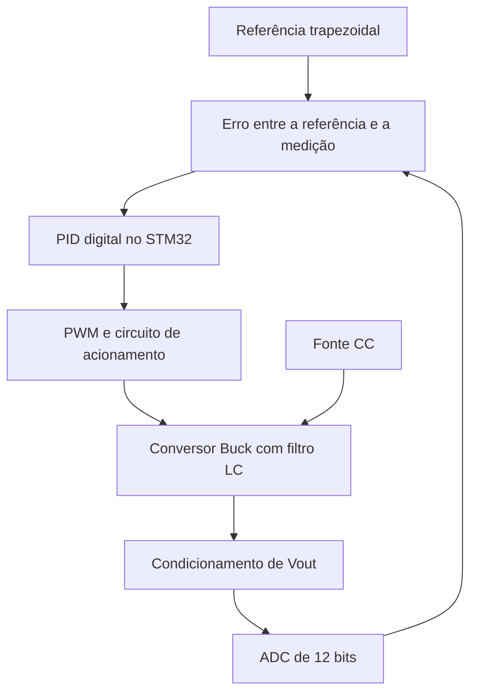

# Controle digital de um conversor Buck

Projeto final de **Controle Automático** da Universidade Tecnológica Federal do Paraná (UTFPR), campus Pato Branco. O objetivo é controlar a tensão de saída de um conversor CC–CC abaixador para que ela acompanhe uma referência trapezoidal entre **6 V e 18 V**, com frequência de **25 Hz**. O protótipo integra um estágio de potência com entrada nominal de **24 V**, um circuito analógico de medição e um controlador digital executado em uma **Blue Pill com STM32F103C8T6**.

**Autores:** Amarildo Piovesan Junior, Erik Takahiro Suzuki e Pedro Antônio Santini.

O [relatório do projeto](Relat%C3%B3rio.pdf) reúne o dimensionamento, os esquemáticos, os trechos da simulação e as medições de bancada. Os arquivos C nesta pasta compõem o firmware embarcado.

## 1. Arquitetura da malha de controle



A planta de potência opera em tempo contínuo. O STM32 mede a saída condicionada e, a cada **100 µs**, compara a leitura com a amostra atual da referência. O controlador usa esse erro para atualizar a razão cíclica do PWM. Assim, quando a saída cai abaixo do valor de referência, a malha pode aumentar o tempo de condução da chave e elevar a tensão média aplicada à carga.

## 2. Estágio de potência e modelagem

O conversor usa um MOSFET **IRFZ44**, um circuito de acionamento com optoacoplador **6N137**, um diodo de roda livre, um indutor de **3,3 mH** e um capacitor de **33 µF**. A carga de bancada é de **15 Ω**. Quando o MOSFET conduz, a fonte fornece energia à carga e ao indutor. Quando ele abre, a corrente do indutor circula pelo diodo. O filtro LC reduz a ondulação produzida pelo chaveamento.

| Parâmetro | Valor |
| --- | ---: |
| Tensão nominal de entrada | 24 V |
| Frequência de chaveamento | 10 kHz |
| Frequência fundamental da referência | 25 Hz |
| Frequência alvo do filtro LC | 500 Hz |
| Frequência natural com os componentes montados | ≈ 482 Hz |
| Fator de amortecimento ideal com carga de 15 Ω | ≈ 0,33 |

Em condução contínua, o modelo médio ideal tem relação estática $V_o = d\,V_{in}$, em que $d$ é a fração do período em que a chave conduz. A função de transferência da razão cíclica para a tensão de saída é

$$
\frac{V_o(s)}{d(s)} =
\frac{V_{in}}{LC}\,
\frac{1}{s^2 + \frac{1}{RC}s + \frac{1}{LC}}
$$

O dimensionamento posiciona a frequência natural do LC entre a fundamental da referência e o chaveamento, usando a média geométrica $\sqrt{25 \times 10\,000} = 500\,\text{Hz}$. Com os componentes escolhidos, o modelo prevê uma resposta subamortecida. Os diagramas de Bode e as respostas ao degrau das Figuras 3 e 4 do relatório mostram a ressonância da planta e a resposta mais rápida do condicionamento. Na Figura 3, o ganho em baixa frequência da planta está normalizado em relação à tensão PWM aplicada ao filtro LC. Quando a entrada do modelo é a razão cíclica, o ganho estático ideal vale $V_{in}$.

No ponto nominal de **12 V** com razão cíclica de **50%**, os cálculos ideais do relatório resultam em corrente média de **0,80 A**, ondulação de corrente pico a pico de aproximadamente **0,18 A** e corrente mínima de aproximadamente **0,71 A**. Isso confirma a condução contínua nesse ponto. A ondulação de tensão estimada é de aproximadamente **69 mV pico a pico** (cerca de **0,57%** de 12 V), dentro do limite de 2% adotado no projeto. A montagem real também está sujeita às perdas do MOSFET e às resistências parasitas do indutor e do capacitor, que afetam o ganho e o amortecimento.

## 3. Condicionamento da tensão de saída

A cadeia de medição adapta a tensão do Buck à faixa de **0 a 3,3 V** do ADC. O sinal condicionado é chamado de **VoA** no relatório e no código.

| Etapa | Componentes | Função |
| --- | --- | --- |
| Atenuação | Divisor de 20 kΩ e 1 kΩ | Reduz a tensão medida por um fator de aproximadamente 1/21. |
| Medição diferencial | Subtrator com resistores de 10 kΩ e ganho unitário | Mede a diferença de potencial e ajuda a rejeitar ruído de modo comum. |
| Filtragem | Sallen–Key com resistores de aproximadamente 30 kΩ e 18 kΩ e capacitores de 10 nF e 4,7 nF | Atenua a ondulação do PWM com um passa-baixas de segunda ordem, corte próximo de 1 kHz e amortecimento de aproximadamente 0,7. |
| Ajuste de offset | Divisor na fonte auxiliar | Desloca a faixa do sinal condicionado para dentro da faixa útil do ADC. |

Os amplificadores operacionais do circuito de bancada usam alimentação simétrica de **±15 V**. No ensaio relatado, **0 V** na saída de potência correspondeu a aproximadamente **0,86 V** na entrada do ADC, e **24 V** corresponderam a aproximadamente **2,0 V**. Esses valores caracterizam a cadeia analógica em bancada. O firmware usa dois outros pontos como referência de calibração, em **6 V** e **18 V**, descritos na seção 5. O esquemático está na Figura 5 do relatório e as capturas de calibração estão nas Figuras 10 e 11.

## 4. STM32, PWM e geração da referência

O STM32F103 opera a **72 MHz**, com HSE de 8 MHz e PLL ×9. O TIM1 conta em modo alinhado ao centro, com prescaler igual a zero e `ARR = 3600`. A subida e a descida do contador completam o período em `2 × 3600` ciclos de clock, resultando em **10 kHz**.

| Pino | Periférico | Uso |
| --- | --- | --- |
| PA0 | ADC1_IN0 | Entrada analógica do sinal VoA condicionado. |
| PA8 | TIM1_CH1 | PWM de potência para o driver do MOSFET. A polaridade baixa do canal compensa a lógica invertida do acionamento. |
| Interno | TIM1_CH2 | Evento de comparação `TIM1_CC2`, com `CCR2 = 3599`, que sincroniza a conversão do ADC perto do pico do contador. |
| PA11 | TIM1_CH4 | PWM para observar a referência em um osciloscópio após um filtro RC externo. |
| PA13 / PA14 | SWDIO / SWCLK | Programação e depuração via SWD. |

O ADC1 opera com resolução de 12 bits, clock de 12 MHz e tempo de aquisição de 55,5 ciclos do ADC. O laço principal inicializa os periféricos e fica vazio. O evento do TIM1 dispara a aquisição e a interrupção de fim de conversão chama `HAL_ADC_ConvCpltCallback()`, que calcula a ação de controle.

O **Sinal 1** é gerado por um contador que percorre 400 amostras e reinicia a cada período de **40 ms**. A referência sobe ou desce **0,6 V por amostra** durante cada rampa de 1 ms.

| Tempo no ciclo | Amostras | Referência |
| --- | --- | --- |
| 0–5 ms | 0–49 | 12 V |
| 5–6 ms | 50–59 | Rampa de 12 V para 18 V |
| 6–15 ms | 60–149 | 18 V |
| 15–16 ms | 150–159 | Rampa de 18 V para 12 V |
| 16–25 ms | 160–249 | 12 V |
| 25–26 ms | 250–259 | Rampa de 12 V para 6 V |
| 26–35 ms | 260–349 | 6 V |
| 35–36 ms | 350–359 | Rampa de 6 V para 12 V |
| 36–40 ms | 360–399 | 12 V |

O canal de visualização em PA11 representa **6 V, 12 V e 18 V** com razões cíclicas de **0%, 50% e 100%**, respectivamente. Após o filtro RC, o osciloscópio exibe o trapézio na escala de saída do GPIO, de aproximadamente **0 a 3,3 V**.

## 5. Controle digital e calibração

Na interrupção do ADC, o código gera a referência atual, lê `adc_value` e converte a referência de volts para contagens do ADC. A escala usa `ADC_VOUT_MIN = 1295` para 6 V e `ADC_VOUT_MAX = 2100` para 18 V. A inclinação é `Kc = (2100 - 1295) / (18 - 6) ≈ 67,08 contagens/V`. A referência convertida é `ref_ADC = 1295 + (ref - 6) * Kc`.

O erro `e[k]` é a diferença entre `ref_ADC` e `adc_value`. O PID posicional aplica estas equações a cada amostra:

```text
uP[k] = Kp * e[k]
uI[k] = limitar(uI[k-1] + Ki * e[k], 0, 3420)
uD[k] = Kd * (e[k] - e[k-1])

CCR1  = inteiro(limitar(uP[k] + uI[k] + uD[k], 180, 3420))
duty = CCR1 / 3600
```

O limite sobre a integral atua como **anti-windup**, reduzindo o acúmulo do erro quando o PWM chega ao limite. A razão cíclica em malha fechada fica entre **5% e 95%**. O limite superior reserva tempo para recarregar o bootstrap do driver. Os ganhos já são discretos e o código aplica diretamente a soma ao registrador de comparação do TIM1.

| Configuração | Controle |
| --- | --- |
| Firmware desta pasta | `Kp = 0,27`, `Ki = 0,10` e `Kd = 0,55`. A parcela derivativa está ativa e o comando é a soma das três ações do PID, com limitação do integrador. |
| Sintonia descrita no relatório | Ações proporcional e integral, derivada zerada para evitar a amplificação do ruído de quantização e parcela de antecipação da referência (*feedforward*). O Quadro 7 da simulação usa a opção `useFF`. |

Essas diferenças devem ser consideradas ao tentar reproduzir as medições do relatório com uma compilação do código atual.

O firmware traz o modo de calibração em `Core/Src/main.c`, desativado por padrão. Com `MODO_CALIBRACAO = 1`, PA8 recebe o comando manual `pwm_manual`, limitado a 3420 contagens, e o ADC continua amostrando. Esse modo permite relacionar as tensões reais de **6,00 V** e **18,00 V**, medidas em bancada, às respectivas leituras de `adc_value` e usar os valores observados para definir `ADC_VOUT_MIN` e `ADC_VOUT_MAX`. O valor `MODO_CALIBRACAO = 0` ativa a malha fechada.

## 6. Simulação computacional

O relatório apresenta o modelo em **MATLAB/Octave** na seção VII, com os trechos principais nos Quadros 3 a 7. Os scripts de simulação não estão incluídos nos arquivos desta pasta.

1. O modelo calcula a frequência natural, o amortecimento e as ondulações de corrente e tensão para conferir os critérios de projeto.
2. As funções de transferência da planta e do filtro Sallen–Key são discretizadas com retenção de ordem zero (ZOH). O trecho mostrado inclui um fator de 1,3 no termo de amortecimento da planta para representar de forma aproximada o efeito das perdas.
3. O controlador é atualizado a cada 100 µs. A planta e a medição são resolvidas em **3600 subpassos por período** no exemplo do relatório, o que permite observar a ondulação dentro do próprio ciclo de PWM.
4. A simulação representa a tensão chaveada, a perturbação na fonte, a atenuação da medição, o ruído, a filtragem, o offset e a quantização do ADC em 12 bits.
5. O algoritmo reconstrói a medição em volts e calcula o comando do próximo período, com limitação da integral, saturação do PWM e opção de *feedforward*.

A Figura 6 ilustra o condicionamento com uma entrada triangular de 60 Hz. A Figura 7 apresenta o rastreamento do Sinal 1 pelo Buck simulado.

## 7. Ensaios de bancada

| Ensaio | Resultado registrado no relatório |
| --- | --- |
| Condicionamento isolado (Fig. 8) | O sinal do gerador foi reproduzido com amplitude reduzida e offset, dentro da faixa do ADC. |
| Malha aberta com entrada de 24 V e razão cíclica de 50% (Fig. 9) | Saída próxima de 12 V com pequena ondulação de chaveamento. |
| Referência no PA11 após filtro RC (Fig. 15) | Trapézio observado no osciloscópio com período de 40 ms. |
| Malha fechada com entrada nominal (Figs. 16 e 17) | A saída reproduziu o perfil de 25 Hz, com patamar inferior próximo de 6 V e alinhamento temporal visível. O relatório registra média próxima de 12,3 V e picos de cerca de 19,2 V nas transições. |
| Malha fechada com entrada elevada a 30 V (Fig. 18) | A malha preservou o perfil trapezoidal, com transitórios de comutação mais pronunciados. |
| Malha fechada com entrada reduzida a 18 V (Fig. 19) | A saída perdeu parte do rastreamento. Com razão cíclica limitada a 95%, o teto ideal é de 17,1 V, antes das perdas, o que torna o patamar de 18 V inalcançável nessa condição. |

A seção VIII-C do relatório identifica a entrada do ensaio inferior como **18 V**. A menção a **6 V** na conclusão diverge dessa seção. **6 V** também é o patamar inferior da referência. O desvio médio observado em bancada foi associado no relatório à calibração da cadeia de medição e à sintonia do controlador.

## 8. Arquivos do projeto

| Arquivo ou pasta | Conteúdo |
| --- | --- |
| [LastDance.ioc](LastDance.ioc) | Configuração do STM32CubeMX, com pinos, clock, ADC, TIM1 e SWD. |
| [Core/Src/main.c](Core/Src/main.c) | Inicialização, geração da referência, calibração e rotina PID. |
| [Core/Src/adc.c](Core/Src/adc.c) e [Core/Src/tim.c](Core/Src/tim.c) | Configuração do ADC, do PWM e do disparo sincronizado. |
| [Core/Src/stm32f1xx_it.c](Core/Src/stm32f1xx_it.c) | Tratamento da interrupção do ADC e encaminhamento para a HAL. |
| [Core/Inc/](Core/Inc/) e [Core/Startup/](Core/Startup/) | Cabeçalhos do projeto e código de inicialização do microcontrolador. |
| [Drivers/](Drivers/) | Bibliotecas STM32 HAL e CMSIS incluídas no projeto. |
| [STM32F103C8TX_FLASH.ld](STM32F103C8TX_FLASH.ld) | Script de linkedição para a memória do STM32F103C8. |
| [LastDance Debug.launch](LastDance%20Debug.launch) | Configuração de gravação e depuração do STM32CubeIDE. |
| [Debug/](Debug/) | Artefatos de compilação, incluindo `LastDance.elf`. |
| [Relatório do projeto](Relat%C3%B3rio.pdf) | Texto técnico, esquemas, figuras de simulação e medições do protótipo. |

## 9. Compilação e depuração

1. No **STM32CubeIDE**, use **File → Import → General → Existing Projects into Workspace** e selecione a pasta raiz. O projeto aparece como **LastDance**.
2. Abra `LastDance.ioc` para consultar os periféricos. A configuração registra **STM32CubeMX 6.15.0** e **STM32Cube FW_F1 V1.8.7**.
3. Compile o projeto na configuração **Debug** para gerar `Debug/LastDance.elf`.
4. Conecte um **ST-LINK** pela interface SWD e execute a configuração **LastDance Debug** para gravar e depurar o firmware.
5. Em **Live Expressions**, acompanhe `ref` e `ref_ADC` para a referência, `adc_value` e `ek` para a leitura e o erro, e `pwm_buck` e `pwm_ref` para os comandos de PWM. Para observar a forma de onda da referência no osciloscópio, use a saída PA11 com o filtro RC externo.
